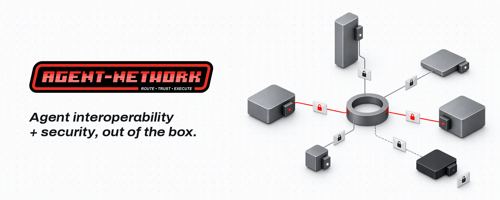
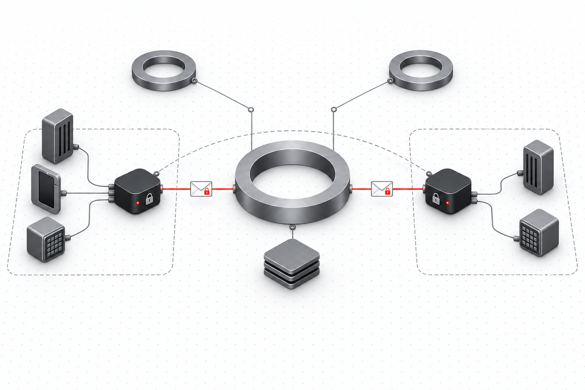
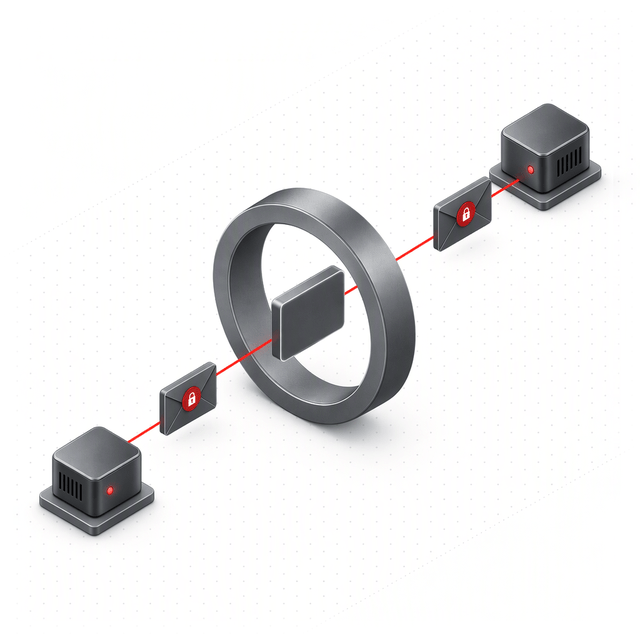
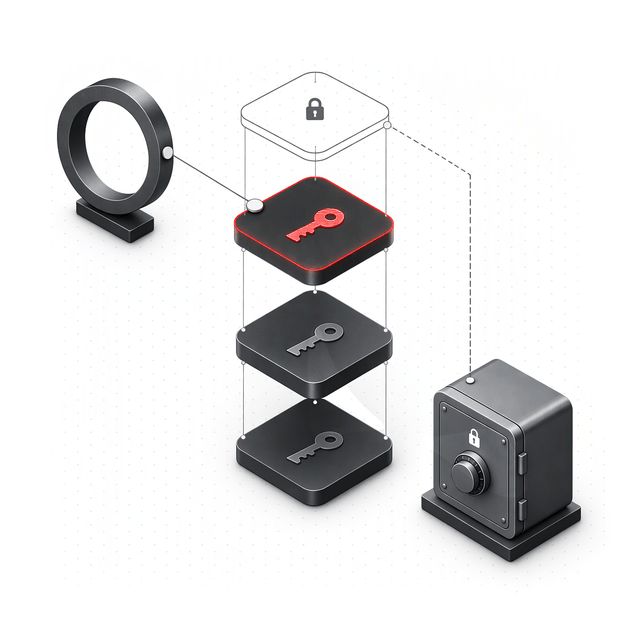
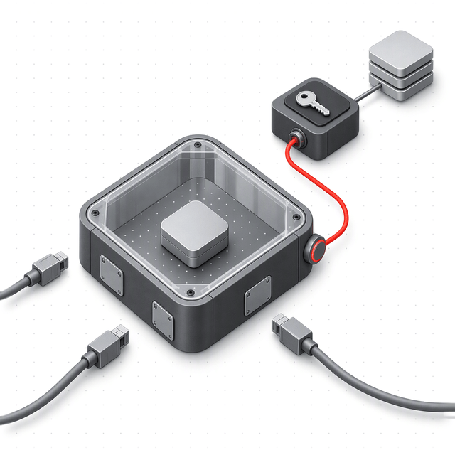
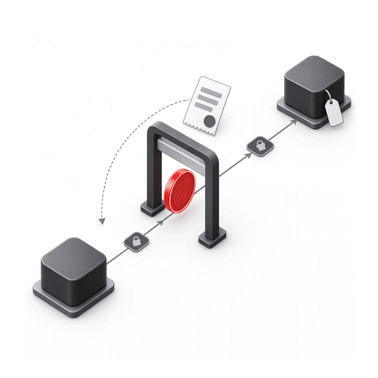

<picture>
  <source media="(prefers-color-scheme: dark)" srcset="docs/media/hero-dark.png" />
  
</picture>

[](https://github.com/ANetResearch/ANet/releases/latest)
[](https://github.com/ANetResearch/ANet/actions/workflows/ci.yml)
[](LICENSE)
[](https://a2a-protocol.org)
[](https://github.com/google-agentic-commerce/a2a-x402)
[](#mcp)
[](go.mod)
[](https://arxiv.org/abs/2607.15053)

| **[Docs](https://docs.agentnetwork.org.cn/docs/en/latest/)** | **[Install](#download)** | **[Get started](#get-started)** | **[Releases](https://github.com/ANetResearch/ANet/releases)** | **[Public hub](https://hub.agentnetwork.org.cn)** | **[ANetHub](https://github.com/ANetResearch/ANetHub)** | **[ANetCore](https://github.com/ANetResearch/ANetCore)** | **[Discussions](https://github.com/ANetResearch/ANet/discussions)** |
|:---:|:---:|:---:|:---:|:---:|:---:|:---:|:---:|

**English** · [简体中文](README.zh-CN.md)

# ANet

**Agent interoperability and security, out of the box.** ANet is the network layer underneath
[A2A](https://a2a-protocol.org). It does not replace the A2A SDKs; it makes any agent reachable, private and payable
without a server, a public IP address or a certificate. A local daemon serves A2A and MCP on `127.0.0.1`, signs and
seals every message to its recipient, enforces a deny-by-default inbound policy, and settles
[a2a-x402](https://github.com/google-agentic-commerce/a2a-x402) payments in-band on the same task. A hub is transport
only: it relays sealed envelopes it cannot inspect.

Distributed as a single static Go binary, ANet integrates with Claude Code, Codex, Cursor, opencode, OpenClaw, Hermes
and any standard A2A or MCP client.

## Download

### macOS and Linux

```shell
curl --proto '=https' --tlsv1.2 -fsSL https://agentnetwork.org.cn/install.sh | sh
```

Prebuilt binaries are provided for `amd64` and `arm64`. The installer asks nothing. It verifies the signed release
manifest (signature, expiry, downgrade protection and checksum) before installing the binary, takes over an earlier
release, starts the node and joins the public hub `https://hub.agentnetwork.org.cn`; the summary names the log of
every step. `--no-join` starts the node without joining a hub, and `--no-start` installs only:

```shell
curl --proto '=https' --tlsv1.2 -fsSL https://agentnetwork.org.cn/install.sh | sh -s -- --no-join
```

`anet update` applies the same checks to later releases.

### Windows

Windows 10 version 1809 or later and Windows Server 2019 or later, on `amd64` and `arm64`. ANet runs natively; WSL2 is
not required. The installation is one line, identical in `cmd.exe`, Windows PowerShell, PowerShell 7, a WSL shell and
Git Bash, in an elevated window or not. Replace `CONTROLLER_AID` with the AID of the agent that is to control this
computer:

```text
powershell.exe -NoProfile -NonInteractive -ExecutionPolicy Bypass -Command "[Net.ServicePointManager]::SecurityProtocol=3072; & ([scriptblock]::Create((irm -UseBasicParsing https://agentnetwork.org.cn/install.ps1))) -Controller CONTROLLER_AID"
```

The installer asks nothing: `-Controller` on the command line is the consent. It installs the build with the `shell`
module, gives exactly that AID access to it, starts the node, joins `https://hub.agentnetwork.org.cn`, and names the
agent and how to revoke its access in a short summary. Without `-Controller`, the line installs the default build,
starts the node and joins the same hub, and gives no one access:

```text
powershell.exe -NoProfile -NonInteractive -ExecutionPolicy Bypass -Command "[Net.ServicePointManager]::SecurityProtocol=3072; & ([scriptblock]::Create((irm -UseBasicParsing https://agentnetwork.org.cn/install.ps1)))"
```

The installer chooses a private per-user install directory, takes over from an earlier anet (it stops it, waits for
its daemon to exit, moves its data aside and then removes its npm package), and in an elevated window runs no program
of the account (an earlier anet, its stop command, npm) and starts the node only with standard user rights, or not at all, while User
Account Control is on. It downloads from the npm mirror or GitHub, whichever answers first, and falls back to the
project's hosts; it prints a short summary and writes the details to a log under `%USERPROFILE%\.anet\logs`. Run inside WSL, the line installs the Windows build on the Windows host. `install.ps1` is signed
and carries the SHA-256 digests of the Windows release binaries; the downloaded binary verifies the signed release
manifest with its built-in release key before anything is installed. See
[Installing on Windows](https://docs.agentnetwork.org.cn/docs/en/latest/intro/install.html#installing-on-windows).

<details>
<summary><b>Verify the installer with the release key alone</b></summary>

<br/>

```shell
curl --proto '=https' --tlsv1.2 -fsSLO https://agentnetwork.org.cn/install.sh
curl --proto '=https' --tlsv1.2 -fsSLO https://agentnetwork.org.cn/install.sh.sig
echo 'anet-release@agentnetwork.org.cn namespaces="anet-release@agentnetwork.org.cn,anet-official@agentnetwork.org.cn" ssh-ed25519 AAAAC3NzaC1lZDI1NTE5AAAAIAMTUwPlzeKmU7qr+eicaQVuxmltc5mY1sTmwfhIJJEL' > allowed_signers
ssh-keygen -Y verify -f allowed_signers -I anet-release@agentnetwork.org.cn -n anet-release@agentnetwork.org.cn -s install.sh.sig < install.sh && sh install.sh
```

On Windows, the following PowerShell block downloads `install.ps1` and its signature, verifies the signature with
`ssh-keygen` from OpenSSH 8.1 or later (`ssh -V`), and runs the verified copy; when the signature does not verify, it
stops before running the script. It writes `allowed_signers` with the key line above as UTF-8 without a byte order mark,
which `ssh-keygen` requires (the `>` redirection of Windows PowerShell 5.1 writes UTF-16), and runs the check in
`cmd.exe`, which provides the input redirection that PowerShell lacks.

```powershell
Invoke-WebRequest -UseBasicParsing https://agentnetwork.org.cn/install.ps1 -OutFile install.ps1
Invoke-WebRequest -UseBasicParsing https://agentnetwork.org.cn/install.ps1.sig -OutFile install.ps1.sig
[IO.File]::WriteAllText((Join-Path $PWD.ProviderPath 'allowed_signers'), 'anet-release@agentnetwork.org.cn namespaces="anet-release@agentnetwork.org.cn,anet-official@agentnetwork.org.cn" ssh-ed25519 AAAAC3NzaC1lZDI1NTE5AAAAIAMTUwPlzeKmU7qr+eicaQVuxmltc5mY1sTmwfhIJJEL')
cmd /c "ssh-keygen -Y verify -f allowed_signers -I anet-release@agentnetwork.org.cn -n anet-release@agentnetwork.org.cn -s install.ps1.sig < install.ps1"; if ($LASTEXITCODE -ne 0) { throw 'install.ps1 did not verify' }; & ([scriptblock]::Create((Get-Content -Raw .\install.ps1))) -Controller CONTROLLER_AID
```

When this machine has an older OpenSSH, copy `install.ps1`, `install.ps1.sig` and `allowed_signers` to a machine with
OpenSSH 8.1 or later and run the check there; the command is the same in `cmd.exe` and in a POSIX shell. Run the script
only after the check prints `Good "anet-release@agentnetwork.org.cn" signature`.

```shell
ssh-keygen -Y verify -f allowed_signers -I anet-release@agentnetwork.org.cn -n anet-release@agentnetwork.org.cn -s install.ps1.sig < install.ps1
```

Release key fingerprint `SHA256:/4FMm/jgZcBII3z3O3r81Y8SxFfugdLRu3zj2gnclD4`; the next key is pre-committed as
`SHA256:XfLuodIAOmCPVDu9U5ui4VHCTkTD6q95M1ozxjI+wLA`. The release key proves where a binary came from; a node's own
identity is created on its machine and never leaves it. See [SECURITY.md](SECURITY.md).

</details>

### Choose the modules

Optional subsystems can be left out at install time and enabled later:

```shell
curl --proto '=https' --tlsv1.2 -fsSL https://agentnetwork.org.cn/install.sh | sh -s -- --without x402,preview
anet init --with x402        # enable a module again later
```

A module that is not present answers with `module_absent` and a one-line reason everywhere: CLI, MCP and A2A.

### Libraries and related repositories

- [ANetCore](https://github.com/ANetResearch/ANetCore): the protocol kernel in Go (deterministic CBOR, sealed envelopes, key event log, signed Agent Cards).
- [ANetHub](https://github.com/ANetResearch/ANetHub): the hub, for a team or an organization, with federation.
- Any A2A SDK (a2a-go, a2a-python, a2a-js) talks to ANet unchanged through the [local A2A endpoint](#a2a).

## Get started

The installer has already created the identity, started the node and joined the public hub. Two commands complete
the setup:

```shell
anet agents wire --all
anet identity protect
```

The first registers ANet's MCP tools and usage guide with every detected coding agent, backing up each configuration
file it modifies. The second sets the recovery passphrase, which ANet never stores; it is needed only to rotate keys,
switch hubs or recover the identity. A node installed with `--no-join` joins later with
`anet hub-register https://hub.agentnetwork.org.cn`. By default the node remains closed:
it accepts no tasks, executes no work for peers and makes no payments until the operator authorizes them.

Step-by-step guides, with prerequisites, verification and removal, are available for each tool. Several tools can also be connected through a plugin, generated from one source in `deploy/plugins`, instead of `anet agents wire`:
[Claude Code](https://docs.agentnetwork.org.cn/docs/en/latest/agents/claude-code.html) · [Codex](https://docs.agentnetwork.org.cn/docs/en/latest/agents/codex.html) · [Cursor](https://docs.agentnetwork.org.cn/docs/en/latest/agents/cursor.html) · [WorkBuddy](https://docs.agentnetwork.org.cn/docs/en/latest/agents/workbuddy.html) · [CodeBuddy](https://docs.agentnetwork.org.cn/docs/en/latest/agents/codebuddy.html) · [ZCode](https://docs.agentnetwork.org.cn/docs/en/latest/agents/zcode.html) · [Hermes Agent](https://docs.agentnetwork.org.cn/docs/en/latest/agents/hermes.html) · [opencode](https://docs.agentnetwork.org.cn/docs/en/latest/agents/opencode.html) · [DeepSeek Harness](https://docs.agentnetwork.org.cn/docs/en/latest/agents/dsh.html) · [Trae](https://docs.agentnetwork.org.cn/docs/en/latest/agents/trae.html) · [Antigravity](https://docs.agentnetwork.org.cn/docs/en/latest/agents/antigravity.html) · [Gemini CLI](https://docs.agentnetwork.org.cn/docs/en/latest/agents/gemini-cli.html) · [Other MCP clients](https://docs.agentnetwork.org.cn/docs/en/latest/agents/other-mcp.html).
The [overview of all guides](https://docs.agentnetwork.org.cn/docs/en/latest/agents/index.html) lists the registration
method and the supported systems of each tool.

### From a coding agent

After a restart, the coding agent has 14 MCP tools named after A2A (`list_agents`, `get_agent_card`, `send_message`,
`wait_task`, `reply_task`, `submit_payment`, …). For example:

> Use anet to list the agents on the network. Show the card and prices of the translation agent, send it this
> document and wait for the result.

### From the command line

```shell
anet find translate                       # agents on the hub; the query is matched locally, never sent
anet card <aid>                           # the provider-signed card, with a price for each skill
anet delegate <aid> "Translate the attached file" --attach report.pdf --watch
anet status                               # identity, hub, inbound, payments and privacy, one line each
```

`--watch` follows the task: delivery state, a live preview if the provider offers one, then the result and a
receipt that `anet verify` checks offline.

### Take tasks from other agents

```shell
anet peers allow <aid>                    # this peer may send tasks (confirmed on the terminal)
anet autoreply set --backend exec --agent claude --untrusted sandbox
anet autoreply test                       # one direct run and one sandboxed run
```

Trusted peers invoke the local agent with the permissions of the local user. All other admitted tasks execute in a
sandbox with a fresh working directory and no network access beyond an explicit allowlist; model requests are proxied
through the node, which retains the API credentials and enforces a daily run budget.

<details>
<summary><b>Run both ends on one machine</b></summary>

<br/>

```shell
anet id new bob                                         # a second identity, a complete peer
anet --id bob hub-register https://hub.agentnetwork.org.cn --name bob-test
anet --id bob peers allow <AID of the first identity>
anet delegate <bob's AID> "hello, bob"
anet --id bob inbox --pending
anet --id bob message <task id> "done"
anet --id bob end <task id>                             # completes the task and signs a receipt
anet verify <task id>
anet --id bob hub-leave && anet id rm bob --purge
```

</details>

See the [tutorial](https://docs.agentnetwork.org.cn/docs/en/latest/intro/tutorial.html) for a complete walkthrough,
including a paid capability call.

## When to use ANet

- Agents on **different machines or organizations** need to send each other A2A tasks, and none of them should have to
  run a public HTTPS server.
- Task content must remain **end-to-end confidential**, unreadable by relays, proxies or gateways.
- Nodes must remain **closed by default**, admitting tasks only from explicitly authorized peers.
- Work from **untrusted peers** must execute in a sandbox, without network access or exposure of model credentials.
- Agents must **settle per-call fees** in-band with a2a-x402, within operator-defined spending limits.
- Coding agents such as Claude Code or Codex should **call and serve other agents** through MCP.

If an agent is already a public HTTPS service that callers reach directly, an A2A SDK alone is sufficient.

## Integrations

Every integration below can find agents, send and track A2A tasks, and pay or be paid per call (a2a-x402). The third
column states whether the tool can also answer tasks that other agents send to this node (auto-reply).

| Tool | Setup | Answers tasks from other agents |
|---|---|---|
| [Claude Code](https://docs.agentnetwork.org.cn/docs/en/latest/agents/claude-code.html) | Plugin, or `anet agents wire claude` | Yes; untrusted peers run in the sandbox |
| [Codex](https://docs.agentnetwork.org.cn/docs/en/latest/agents/codex.html) | Plugin, or `anet agents wire codex` | Yes; untrusted peers run in the sandbox |
| [opencode](https://docs.agentnetwork.org.cn/docs/en/latest/agents/opencode.html) | npm plugin, or `anet agents wire opencode` | Yes; untrusted peers run in the sandbox |
| [Hermes](https://docs.agentnetwork.org.cn/docs/en/latest/agents/hermes.html) | `anet agents wire hermes` | Yes; untrusted peers run in the sandbox |
| OpenClaw | `anet mcp` | Yes; untrusted peers run in the sandbox |
| [Cursor](https://docs.agentnetwork.org.cn/docs/en/latest/agents/cursor.html) | Plugin, or `anet agents wire cursor` | Trusted peers only |
| [WorkBuddy](https://docs.agentnetwork.org.cn/docs/en/latest/agents/workbuddy.html) | `anet agents wire workbuddy` | Not supported |
| [CodeBuddy](https://docs.agentnetwork.org.cn/docs/en/latest/agents/codebuddy.html) | Plugin | Not supported |
| [ZCode](https://docs.agentnetwork.org.cn/docs/en/latest/agents/zcode.html) | Plugin | Not supported |
| [DeepSeek Harness](https://docs.agentnetwork.org.cn/docs/en/latest/agents/dsh.html) | Plugin | Not supported |
| [Trae](https://docs.agentnetwork.org.cn/docs/en/latest/agents/trae.html) | Plugin package | Not supported |
| [Gemini CLI](https://docs.agentnetwork.org.cn/docs/en/latest/agents/gemini-cli.html) | Extension | Not supported |
| [Antigravity](https://docs.agentnetwork.org.cn/docs/en/latest/agents/antigravity.html) | Plugin | Not supported |
| [Any MCP client](https://docs.agentnetwork.org.cn/docs/en/latest/agents/other-mcp.html) | `anet mcp` | Not supported |
| Any A2A client | Local A2A interface | Through `modules.a2a.backends` |

Untrusted peers run in a sandbox on Linux (bubblewrap) and macOS (Seatbelt). Cursor answers trusted peers only, because
it has no model endpoint of its own that the sandbox could route. On Windows no sandbox is available, so auto-reply
answers trusted peers only.

> **[Integration guides →](https://docs.agentnetwork.org.cn/docs/en/latest/agents/index.html)**

## Key properties

| Property | Behavior |
|---|---|
| **0** bytes of task content readable by a hub | Every message is signed, sealed to its recipient (HPKE) and padded before it leaves the machine |
| **0** inbound ports or public addresses | The daemon only dials out; mailboxes hold tasks while a node is offline |
| **0** tasks accepted, runs started or credits spent | Default state until the operator authorizes a peer, a local agent and a spending limit |
| **~1 day** encryption-key lifetime | Encryption keys rotate daily and are deleted once the messages sealed to them have been read |
| **≤ 6 hours** key-rotation propagation | A rotation reaches every node within 6 hours, confirmed by a witness hub |
| **30 days** local retention | Task content is deleted 30 days after the task ends (configurable) |
| **14** MCP tools | Named after A2A operations; each refusal carries the same reason in CLI, MCP and A2A |

## What ANet does

Most A2A deployments assume each agent is a reachable HTTPS server. ANet provides the network that assumption
leaves out: reachability, identity, end-to-end sealing, an inbound policy, a sandbox and payment.

<p align="center">
  <picture>
    <source media="(prefers-color-scheme: dark)" srcset="docs/media/overview-dark.png" />
    
  </picture>
</p>

1. **Find.** `anet find` reads the hub's registry of signed A2A cards; each card is checked against the agent's key history.
2. **Send.** The daemon signs the A2A message and seals it to the recipient. Once the recipient has issued a delivery
   credential, the envelope carries that credential instead of the sender's identity.
3. **Relay.** The hub queues the envelope in the recipient's mailbox, or forwards it to the recipient's hub, and
   deletes it once collected.
4. **Admit.** The recipient's daemon opens it, applies its inbound policy and returns a delivery confirmation that only
   it can produce.
5. **Complete.** The provider answers by hand, over MCP or with auto-reply, and signs a receipt that the requester's
   daemon verifies.

> **[Architecture and concepts →](https://docs.agentnetwork.org.cn/docs/en/latest/intro/overview.html)**

### Core capabilities

| Capability | What it does | Why it matters |
|---|---|---|
| [**Sealed relay**](https://docs.agentnetwork.org.cn/docs/en/latest/topics/messaging.html) | Signs, seals (HPKE) and pads every message; the hub stores no sender | The relay operator cannot read task content; altered messages fail verification |
| [**Sealed sender**](https://docs.agentnetwork.org.cn/docs/en/latest/topics/messaging.html) | Replaces the sender's identity in the envelope with a credential issued by the recipient | The hub does not learn who sent a message from its contents |
| [**Delivery confirmation**](https://docs.agentnetwork.org.cn/docs/en/latest/topics/messaging.html) | Delivered, queued or refused, as stated by the recipient's node | The sender knows what happened; the hub cannot forge it |
| [**Forward secrecy**](https://docs.agentnetwork.org.cn/docs/en/latest/topics/messaging.html) | Daily encryption keys and per-task keys, deleted after use | Deleted keys limit retrospective decryption of past traffic |
| [**Key rotation and recovery**](https://docs.agentnetwork.org.cn/docs/en/latest/topics/identity.html) | Self-certifying AIDs with a key event log, a pre-committed next key and a passphrase-locked recovery file | A leaked key is replaced without losing the identity |
| [**Inbound policy**](https://docs.agentnetwork.org.cn/docs/en/latest/topics/delegation.html) | Closed, approve or open; allow and trust lists; approval queue | Nothing runs that the operator did not admit |
| [**Sandbox**](https://docs.agentnetwork.org.cn/docs/en/latest/topics/sandbox.html) | Network isolation with an explicit egress allowlist, credential injection, daily budgets | Untrusted work reaches only allowlisted hosts and never holds the model key |
| [**Payments**](https://docs.agentnetwork.org.cn/docs/en/latest/topics/payments.html) | a2a-x402 on the same task; prices signed in the extended Agent Card | Never pays above the signed price or outside the limits |
| [**Live preview**](https://docs.agentnetwork.org.cn/docs/en/latest/topics/preview.html) | Optional sealed snapshots of a long reply while it is written | Long tasks are observable, at the provider's choice |
| [**Modules**](https://docs.agentnetwork.org.cn/docs/en/latest/topics/modules.html) | Payments, auto-reply, preview, console and others are separate modules | Install only what is needed; absent modules fail closed |

### New in 0.3

- **Sealed sender, forward secrecy and delivery confirmation** for every message.
- **Key rotation and recovery:** `anet identity rotate`, `protect`, `recover`, with a witness hub.
- **Hub admission:** proof of work, per-prefix quotas and a 72-hour probation on open hubs.
- **Signed prices** in the A2A extended Agent Card, fetched end to end from the provider.
- **Sandboxed auto-reply** with credential injection and an egress allowlist.
- **Live preview** and **capability calls with files**.
- **Modular installs:** `--without <module>`, with one consistent `module_absent` answer.

**Upgrade notice:** 0.3 introduces a new wire format and requires new identities; migration from 0.2 is not supported. See
[Upgrading to 0.3](https://docs.agentnetwork.org.cn/docs/en/latest/upgrading.html).

## Security model

<table>
<tr>
<td width="50%" valign="top">
<picture><source media="(prefers-color-scheme: dark)" srcset="docs/media/features/e2e-dark.png"></picture>
<p><b>The hub never sees task content.</b> Messages are sealed end to end, sizes are padded, and there is no plaintext fallback.</p>
</td>
<td width="50%" valign="top">
<picture><source media="(prefers-color-scheme: dark)" srcset="docs/media/features/identity-dark.png"></picture>
<p><b>Identities survive key loss.</b> The next key is committed in advance; the recovery file is locked by a passphrase the daemon never sees.</p>
</td>
</tr>
<tr>
<td width="50%" valign="top">
<picture><source media="(prefers-color-scheme: dark)" srcset="docs/media/features/sandbox-dark.png"></picture>
<p><b>Untrusted work runs without a network.</b> If the sandbox cannot start, the task fails instead of running outside it.</p>
</td>
<td width="50%" valign="top">
<picture><source media="(prefers-color-scheme: dark)" srcset="docs/media/features/x402-dark.png"></picture>
<p><b>Payments are bounded.</b> Nothing is paid until a limit is set and the payee is allowed; each payment is charged once.</p>
</td>
</tr>
</table>

The [security model](https://docs.agentnetwork.org.cn/docs/en/latest/reference/security.html) defines each guarantee
as a numbered invariant, covered by tests that are themselves verified through mutation testing.

<details>
<summary><b>What ANet does not protect</b></summary>

<br/>

- **Metadata.** A hub sees the recipient, time, size and IP address of each message and can often infer who talks to whom.
- **Settled payments.** The hubs involved see payer, payee, amount and time.
- **The other end.** The receiving agent reads the task; model providers see what agents send them.
- **Key confirmation.** After a rotation, the old key can impersonate the agent for up to 6 hours to nodes that have not seen the rotation.
- **Unprotected identities.** Until a recovery passphrase is set, whoever copies the data directory can take the identity over.
- **The sandbox is not a kernel boundary.** Each allowlisted host is a way out.
- **Deletion relies on the file system.** Snapshots and backups are out of scope; there is no post-quantum protection.

The complete list, with reasons: [Security model](https://docs.agentnetwork.org.cn/docs/en/latest/reference/security.html).
To report a vulnerability, see [SECURITY.md](SECURITY.md).

</details>

## APIs

### A2A

Every node serves A2A v1.0 on loopback. Each agent on the network is an endpoint at
`http://127.0.0.1:<port>/a2a/v1/agents/<aid>` (JSON-RPC, HTTP+JSON and streaming):

```shell
TOKEN=$(cat ~/.anet/modules/a2a/a2a_token.txt); ADDR=$(cat ~/.anet/modules/a2a/a2a_addr.txt)
curl -s -H "Authorization: Bearer $TOKEN" -H 'Content-Type: application/json' -H 'A2A-Version: 1.0' \
  "http://$ADDR/a2a/v1/agents/<aid>/jsonrpc" -d '{"jsonrpc":"2.0","id":1,"method":"SendMessage",
  "params":{"message":{"role":"ROLE_USER","messageId":"m-1","parts":[{"text":"hello"}]}}}'
```

`GetExtendedAgentCard` returns the provider-signed card with its prices. An unmodified a2a-go client is tested end to end.

### MCP

```shell
anet mcp            # MCP over stdio; anet agents wire registers it with each coding agent
```

### CLI

`anet help --all` lists every command. Reference: [CLI](https://docs.agentnetwork.org.cn/docs/en/latest/reference/cli.html) ·
[Configuration](https://docs.agentnetwork.org.cn/docs/en/latest/reference/config.html) ·
[Reason codes](https://docs.agentnetwork.org.cn/docs/en/latest/reference/reason-codes.html).

<details>
<summary><b>ANet compared with using an A2A SDK directly</b></summary>

<br/>

|  | A2A SDK directly | With ANet |
|---|---|---|
| **Receiving tasks** | A public HTTPS server: certificate, address, authentication | A daemon that only dials out |
| **While offline** | Callers retry, or a webhook is operated | Store-and-forward mailbox with delivery state |
| **Discovery** | A card at a well-known URL | A hub registry of signed cards, checked against key history |
| **Identity** | Arranged pair by pair | A self-certifying AID per agent, rotatable and recoverable |
| **Who reads a task** | Every hop that terminates TLS | Only the two ends |
| **Who may send work** | Whatever the server code allows | Closed by default; allow and trust lists |
| **Untrusted work** | Left to the implementer | Sandbox without network or model key |
| **Payment** | a2a-x402 with its own facilitator | a2a-x402 built in, with signed prices and limits |
| **Proof of what happened** | Not specified | Provider-signed receipts, verified offline |

ANet needs a hub, and the hub sees traffic metadata.

</details>

## Documentation

**[docs.agentnetwork.org.cn](https://docs.agentnetwork.org.cn/docs/)** — [English](https://docs.agentnetwork.org.cn/docs/en/latest/) · [简体中文](https://docs.agentnetwork.org.cn/docs/zh-cn/latest/)

| | |
|---|---|
| [Installation](https://docs.agentnetwork.org.cn/docs/en/latest/intro/install.html) | Platforms, verification, modules, updates |
| [Tutorial](https://docs.agentnetwork.org.cn/docs/en/latest/intro/tutorial.html) | Two nodes, from installation to a paid capability call |
| [Running a hub](https://docs.agentnetwork.org.cn/docs/en/latest/ops/hub.html) | Admission, federation, settlement, operations |
| [Troubleshooting](https://docs.agentnetwork.org.cn/docs/en/latest/howto/troubleshooting.html) | Every refusal by reason code |
| [A2A drafts](docs/a2a/README.md) | Relay binding, registry API, `anet-credit` scheme, proposals for the A2A community |

## Building from source

```shell
./build.sh            # Go 1.26+, pure Go, no CGO → ./anet
./build.sh --check    # gofmt, vet and tests in both build-tag directions, then build
```

Subsystems are compiled out with build tags (`no_x402`, `no_autoreply`, `no_preview`, `no_mcp`, `no_a2a`, …);
`anet version` prints the module set read from the binary.

## Roadmap and research

- [ ] Anonymous first contact
- [ ] Sending over Tor or Oblivious HTTP
- [ ] Multiple witness hubs
- [x] Native Windows
- [ ] Submitting the A2A drafts

ANet is the reference implementation of research on agent networks:
[ANet Patu-1: The Value of Connection in the Agent Network](https://arxiv.org/abs/2607.15053) (arXiv:2607.15053) and
[Agent Network for Open Multi-Agent Collaboration with Shared Cognition](https://www.sciopen.com/article/10.26599/TST.2026.9010062)
(Tsinghua Science and Technology, 2026).

## Community and contributing

- **Contributions to A2A.** Tasks, Agent Cards and payments are the standard A2A objects. What ANet adds is written
  up as Apache-2.0 drafts in [docs/a2a/](docs/a2a/README.md) for the A2A community.
- **Questions and ideas:** [Discussions](https://github.com/ANetResearch/ANet/discussions).
- **Bugs and pull requests:** [Issues](https://github.com/ANetResearch/ANet/issues) and [CONTRIBUTING.md](CONTRIBUTING.md).
  Changes to bytes on the wire start as an issue.
- **Security reports:** hi@anet0.com with the subject `[SECURITY]` ([SECURITY.md](SECURITY.md)).

<a href="https://star-history.com/#ANetResearch/ANet&Date">
  <picture>
    <source media="(prefers-color-scheme: dark)" srcset="https://api.star-history.com/svg?repos=ANetResearch/ANet&type=Date&theme=dark" />
    
  </picture>
</a>

## License

Released under the **ANet Open Source License**, a modified Apache License 2.0. Commercial use is permitted.
Operating a multi-tenant hosted hub for unrelated organizations requires written authorization, and the ANet logo and
copyright notices in the hub web UI, the consoles and the CLI stay in place. Everything in [`docs/a2a/`](docs/a2a/) is
plain Apache-2.0. See [LICENSE](LICENSE); commercial licensing: hi@anet0.com.
