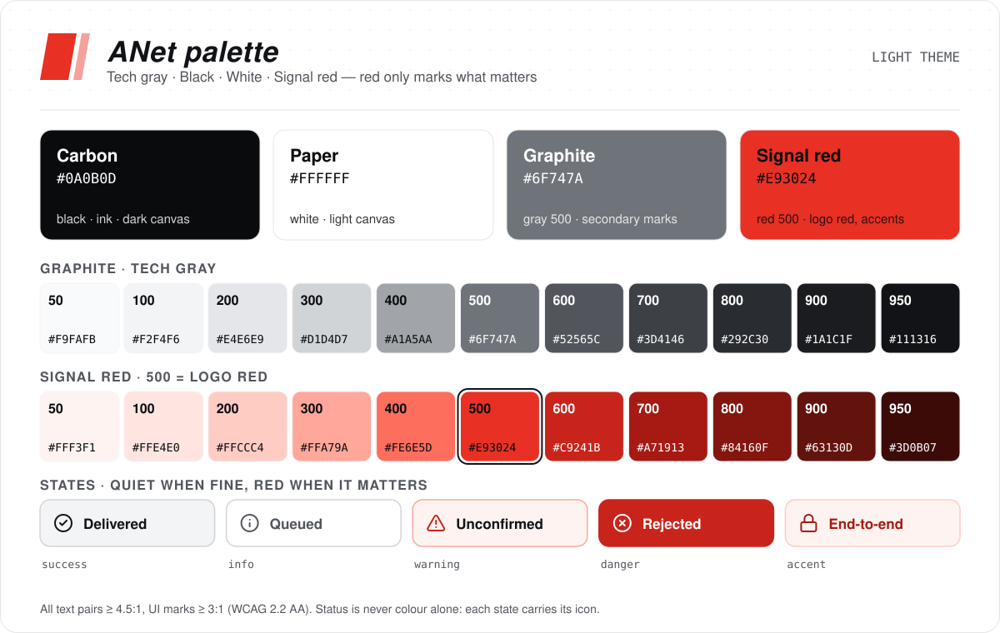

# ANet brand guide

This guide covers the logo, colours, type, icons and illustrations of ANet, ANetCore and ANetHub: their READMEs, the documentation site, the local console and the hub web UI. Every file it names lives under [`docs/media/`](media/).

**In one line:** tech gray as the ground, black and white for structure, and red only for the one thing that matters.

<picture>
  <source media="(prefers-color-scheme: dark)" srcset="media/brand/palette-dark.svg" />
  
</picture>

## Principles

1. **Red is a signal, not decoration.** One red focus per screen or image: the key action, a failure, the encrypted path, or the brand mark. Everything else is gray, black and white.
2. **Show what is true.** Pictures and copy claim no more than the software does. The hub relays sealed envelopes it cannot open, but it still sees metadata such as the recipient, the time and the size; [KNOWN-LIMITATIONS.md](KNOWN-LIMITATIONS.md) lists exactly what. No picture suggests a protection we do not provide.
3. **Never colour alone.** Every state carries an icon and a word. Success stays neutral, a warning is calm text with a red signal, a failure is solid red.

---

## 1. Logo

| File | What it is |
|---|---|
| [`media/anet-logo.svg`](media/anet-logo.svg) | The primary logo, a horizontal plate. Use it as is. |
| [`media/brand/anet-mark.png`](media/brand/anet-mark.png) | The speech-bubble mark (the organisation avatar), 460 × 460. For avatars, favicons and spots below 160 px. Raster only for now. |

**Anatomy of the plate.** A black rounded parallelogram leaning forward 10°; a red open frame (`#E93024`) running inside it, broken at the lower right where the tagline sits; the `AGENT-NETWORK` wordmark in red with white horizontal scanlines that thicken towards the bottom; the tagline `ROUTE • TRUST • EXECUTE` in white italic.

**The mark.** A black rounded speech bubble with a thick red outline. Inside: a small network of red rounded-square nodes joined by thin white lines, and a smile drawn from two white squares and an arc.

The brand motifs come from these two: the 10° slant, rounded-square nodes, the open frame (a gap left for a label), the scanline texture, and black plate, red frame, white type as the order of layers.

**Use**

- **Clear space:** at least the height of the wordmark letters (about a third of the plate height) on every side. In a banner, keep at least half the plate height around it.
- **Minimum size:** the plate at 160 px wide on screen. The tagline is legible from about 480 px; below that it is texture. Smaller than 160 px, use the mark (at least 24 px).
- **Backgrounds:** Carbon, gray 900–950 or pure black, where the plate merges with the page; or white and gray 50–100, where it reads as a black badge. Not on mid grays (400–600), on red, on photos or on busy illustrations.
- **Do not** recolour it (including swapping the red or inverting it), remove the black plate, stretch, change the slant, rotate, outline, add shadows, or add a red glow on light backgrounds. Image generators never draw the logo or the wordmark: we composite the real file afterwards.
- **"ANet" in type:** "A" in red 500, "Net" in the text colour (white on dark, Carbon on light), set in Archivo Expanded Black Italic (wdth 125, wght 900). Product names follow the same pattern: **A**NetHub, **A**NetCore.

The ANet logo and copyright notices in ANet's user interfaces are covered by condition 1.b of the [LICENSE](../LICENSE).

---

## 2. Colour

The palette is designed in OKLCH so the steps look evenly spaced, and every text and graphic pair below is checked against WCAG 2.2 AA (text ≥ 4.5:1, interface and graphics ≥ 3:1). Machine-readable tokens, including every contrast pair: [`media/brand/palette.json`](media/brand/palette.json).

### 2.1 The four colours

| Name | Hex | Role |
|---|---|---|
| **Carbon** black | `#0A0B0D` | The UI black: dark canvas, text on light themes. Pure `#000000` is for the logo plate only. |
| **Paper** white | `#FFFFFF` | Light canvas, text on dark themes. |
| **Graphite** tech gray | `#6F747A` (gray 500) | A cool neutral gray (OKLCH hue 255, chroma ≤ 0.011) that does not turn blue next to red. |
| **Signal red** | `#E93024` (red 500) | The red of the logo frame, and the anchor of the red ramp. |

### 2.2 Ramps

Contrast ratios are against white `#FFFFFF` and Carbon `#0A0B0D`.

| Step | Graphite gray | on white | on Carbon | Signal red | on white | on Carbon |
|---|---|---|---|---|---|---|
| 50 | `#F9FAFB` | 1.05 | 18.84 | `#FFF3F1` | 1.09 | 18.13 |
| 100 | `#F2F4F6` | 1.10 | 17.86 | `#FFE4E0` | 1.21 | 16.34 |
| 200 | `#E4E6E9` | 1.25 | 15.75 | `#FFCCC4` | 1.43 | 13.77 |
| 300 | `#D1D4D7` | 1.49 | 13.23 | `#FFA79A` | 1.87 | 10.54 |
| 400 | `#A1A5AA` | 2.48 | 7.95 | `#FE6E5D` | 2.76 | 7.13 |
| 500 | `#6F747A` | 4.71 | 4.18 | `#E93024` | 4.27 | 4.61 |
| 600 | `#52565C` | 7.38 | 2.67 | `#C9241B` | 5.60 | 3.52 |
| 700 | `#3D4146` | 10.28 | 1.92 | `#A71913` | 7.52 | 2.62 |
| 800 | `#292C30` | 14.03 | 1.40 | `#84160F` | 9.99 | 1.97 |
| 900 | `#1A1C1F` | 17.08 | 1.15 | `#63130D` | 12.89 | 1.53 |
| 950 | `#111316` | 18.61 | 1.06 | `#3D0B07` | 16.81 | 1.17 |

**Red rules**

- Red 500 on white is 4.27:1, short of body text. On light backgrounds use it for marks, rules, icons, focus rings and display type of 24 px or more. Red text and links use red 600 `#C9241B` on light (5.60:1) and red 400 `#FE6E5D` on dark (7.13:1).
- Solid buttons are red 600 with white text in both themes (5.60:1); hover red 700, pressed red 800. Never white text on red 500.
- One solid red button per screen. Secondary actions are outlined or ghost buttons in gray.
- Glow only on dark backgrounds and only on red: blur 8–16 px, opacity at most 40 %. On light backgrounds red is always flat.

### 2.3 Semantic tokens

| Token | Light | Dark |
|---|---|---|
| `bg.canvas` | `#FFFFFF` white | `#0A0B0D` Carbon |
| `bg.surface` | `#F9FAFB` gray.50 | `#111316` gray.950 |
| `bg.subtle` | `#F2F4F6` gray.100 | `#1A1C1F` gray.900 |
| `bg.inverse` | `#111316` gray.950 | `#F9FAFB` gray.50 |
| `border.subtle` | `#F2F4F6` gray.100 | `#1A1C1F` gray.900 |
| `border.default` | `#E4E6E9` gray.200 | `#292C30` gray.800 |
| `border.strong` | `#D1D4D7` gray.300 | `#3D4146` gray.700 |
| `border.control` (inputs and other control edges) | `#6F747A` gray.500 | `#6F747A` gray.500 |
| `text.primary` | `#111316` gray.950 | `#F9FAFB` gray.50 |
| `text.secondary` | `#52565C` gray.600 | `#A1A5AA` gray.400 |
| `text.disabled` (carries no information) | `#A1A5AA` gray.400 | `#52565C` gray.600 |
| `text.inverse` | `#FFFFFF` white | `#111316` gray.950 |
| `text.on-accent` | `#FFFFFF` white | `#FFFFFF` white |
| `accent.brand` (marks, rules, graphics) | `#E93024` red.500 | `#E93024` red.500 |
| `accent.fg` (links, emphasised text) | `#C9241B` red.600 | `#FE6E5D` red.400 |
| `accent.solid` / `-hover` / `-active` | red.600 / red.700 / red.800 | red.600 / red.700 / red.800 |
| `accent.subtle-bg` / `-fg` / `-border` | red.50 / red.700 / red.200 | red.950 / red.300 / red.800 |
| `focus.ring` (2 px, offset 2 px) | `#E93024` red.500 | `#E93024` red.500 |
| `success.fg` / `bg` / `border` / `icon` | gray.950 / gray.100 / gray.300 / gray.950 | gray.50 / gray.900 / gray.700 / gray.50 |
| `success.solid` / `on-solid` | gray.950 / white | gray.50 / gray.950 |
| `warning.fg` / `bg` / `border` / `icon` | gray.950 / red.50 / red.300 / red.600 | gray.50 / gray.900 / red.800 / red.400 |
| `danger.fg` / `bg` / `border` / `icon` | red.700 / red.100 / red.500 / red.600 | red.300 / red.950 / red.500 / red.400 |
| `danger.solid` / `on-solid` | red.600 / white | red.600 / white |
| `code.bg` / `code.fg` | gray.50 / gray.900 | gray.950 / gray.100 |

### 2.4 States within gray, black, white and red

There is no green and no blue: success is neutral, and red is kept for what needs attention.

| State | Icon | Treatment | Examples |
|---|---|---|---|
| Success | `ok` (circle-check) | Ink text and icon, light gray fill, gray border | Delivered; `anet doctor` all clear |
| Info, queued | info or a dashed circle | Secondary gray text, canvas fill, gray border | Queued; awaiting approval |
| Warning | `warn` (triangle-alert) | Text stays in the body colour; red only on the icon and border; a faint red 50 fill (light) or gray 900 (dark) | Delivery unconfirmed; no recovery phrase set yet |
| Failure, refusal | `fail` (circle-x) | Solid red 600 with white text, or red 700 (light) / red 300 (dark) text on a subtle red fill | Rejected; over quota |
| Protected, encrypted | `e2ee` or a lock | The `accent.subtle` set | End-to-end |

### 2.5 Badges

Shields badges use the same colours: the most important one (release) in `C9241B` (white text, 5.60:1), the rest in `1A1C1F` or `3D4146`. No cyan, blue or other reds.

---

## 3. Type

All fonts are open source under the SIL Open Font License 1.1. The repositories do not ship font files.

| Use | Latin | Chinese |
|---|---|---|
| Display (banners, headings, big numbers) | **Archivo**, variable: Expanded (wdth 112–125), weight 800–900; italic for hero lines, echoing the logo's slant | **Smiley Sans**, an oblique wide sans whose slant matches the logo |
| Interface and body | **IBM Plex Sans** 400 / 500 / 600 | **Noto Sans SC** (Source Han Sans SC) 400 / 500 / 700 |
| Monospace (commands, AIDs, hashes, hex values) | **IBM Plex Mono** 400 / 500 | **Sarasa Mono SC** as the fallback for mixed terminal text |

```css
--font-display: "Archivo", "Smiley Sans", "Noto Sans SC", system-ui, sans-serif;
--font-sans: "IBM Plex Sans", "Noto Sans SC", "Source Han Sans SC", "PingFang SC", "Microsoft YaHei", system-ui, sans-serif;
--font-mono: "IBM Plex Mono", "Sarasa Mono SC", ui-monospace, "SFMono-Regular", Menlo, Consolas, monospace;
```

- Scale (px): 12 / 14 / 16 (body) / 18 / 20 / 24 / 32 / 40 / 56 / 72. Line height 1.6 for body, 1.15 for headings.
- Display tracking 0 to +0.5 %. All-caps labels: +8 % tracking, weight 600, `text.secondary`.

---

## 4. Shape and graphic language

| Element | Rule |
|---|---|
| **Slant** | 10° forward (`skewX(-10deg)`), from the logo. For display type, badges, tags and flat tiles in illustrations. Body text and controls stay upright. |
| **Grid** | 8 px base, 4 px half step. Spacing: 4 / 8 / 12 / 16 / 24 / 32 / 48 / 64 / 96. |
| **Radii** | xs 4, sm 6, md 10, lg 16, xl 24, pill 999. Node and avatar squares: 22 % of the side. Large cards 16–20. |
| **Strokes** | Icons 1.75 on the 24 grid; hairlines 1; connectors 1.5; node outlines 2; the emphasised (red) path 3. |
| **Dot grid** | 24 px pitch, 1.5 px dots; white at 8 % on dark, black at 10 % on light. Background layer of banners and illustrations only. |
| **Scanlines** | From the wordmark: horizontal white bars inside a red shape, thin at the top and thicker towards the bottom. A signature texture: at most once per image. |
| **Open frame** | From the logo: a stroked frame broken at the lower right, with a label or number in the gap. For feature cards and step numbers. |
| **Diagram vocabulary** | An agent is a rounded-square node, with one red light when active. A hub or relay is a hollow graphite ring, drawn empty: it carries envelopes and does not see inside them. A message is a sealed envelope with a lock. A refusal is solid red with `fail`. |
| **Shadows** | Light: `0 1px 2px rgb(10 11 13 / .06), 0 4px 12px rgb(10 11 13 / .06)`. Dark: no shadows; `border.default` plus a 1 px inner highlight `rgb(255 255 255 / .04)`. |

---

## 5. Icons and toggles

### 5.1 Where the icons come from

The icon shapes are not drawn by us, and the licences below travel with them:

| Component | Licence | Copyright | How we use it |
|---|---|---|---|
| **Lucide** v1.51.0 | ISC | © 2026 Lucide Icons and Contributors | The geometry of every icon except `github` |
| **Feather** (inside Lucide) | MIT | © 2013-present Cole Bemis | Some Lucide glyphs derive from Feather (among ours: check, the chevrons, x, moon, circle-x, triangle-alert, and the info and lock glyphs on the colour card); Lucide's licence file carries this notice |
| **Tabler Icons** v3.48.0 | MIT | © 2020-2026 Paweł Kuna | The `github` glyph only |
| **morphicons** v1.7.1 | MIT | © 2026 Guillermo | The engine for icon transitions: it computed the frames of the animated SVGs in `icons/anim/`, and is the engine for the toggles on ANet's web pages (section 5.5) |

Full licence texts: [`media/icons/LICENSES/`](media/icons/LICENSES/). Each SVG names its source in a comment. When you copy the icons, keep the `LICENSES` folder with them; inline scripts keep their `/*! … */` licence header.

The GitHub mark is a trademark of GitHub. The icon licence grants no trademark rights: we use it only to link to our repositories, in one colour, and never in a combined mark.

### 5.2 Specification

- 24 × 24 viewBox, stroke 1.75 (about 1.17 px at 16 px), round caps and joins, outlines only.
- Sizes 16 / 20 / 24 in interfaces; 24–48 in READMEs.
- In interfaces the colour is `currentColor`: `text.secondary` at rest, `text.primary` on hover or when selected. Red only for the key action and for warning and failure states.
- In the coloured files, each feature icon has exactly one red element (its accent); interface icons are single-colour; status icons take their whole colour from the status (`ok` neutral, `warn` and `fail` red).

### 5.3 Files

| Folder | Use |
|---|---|
| `media/icons/light/`, `media/icons/dark/` | Coloured for light and dark pages; pair them in a `<picture>`. |
| `media/icons/tile/` | The icon on its own dark rounded tile (48 × 48, gray 900 fill, gray 700 border). One file that reads on both GitHub themes, and in renderers that ignore `<picture>`. |
| `media/icons/anim/light/`, `media/icons/anim/dark/` | Four looping transitions as plain SVG animation, no script; they play inside ``. With reduced motion turned on, only the end state shows. Use one or two per page at most. |

```html
<!-- A coloured icon that follows the reader's GitHub theme -->
<picture>
  <source media="(prefers-color-scheme: dark)" srcset="docs/media/icons/dark/e2ee.svg">
  
</picture>

<!-- A tile: one file for both themes -->


<!-- An animation: give it a real alt text -->
<picture>
  <source media="(prefers-color-scheme: dark)" srcset="docs/media/icons/anim/dark/key-burn.svg">
  
</picture>
```

Next to a text label, an icon is decoration: `alt=""`.

### 5.4 Index

| File | Meaning | Lucide name |
|---|---|---|
| `install` | One-command install | square-terminal |
| `a2a` | A2A interoperability | arrow-left-right |
| `mcp` | MCP | plug |
| `e2ee` | End-to-end encryption | message-square-lock |
| `hub-relay` | The hub only relays | route |
| `sealed-sender` | Sender hidden from the hub | hat-glasses |
| `receipt` | Delivery receipts | check-check |
| `forward-secrecy` | Forward secrecy: keys are deleted | flame |
| `key-rotation` | Identity and key rotation | rotate-ccw-key |
| `recovery` | Recovery phrase | scroll-text |
| `payment` | Payments (a2a-x402) | circle-dollar-sign |
| `price` | Prices on agent cards | tag |
| `sandbox` | Sandbox | box |
| `egress` | Allowlisted egress | globe-lock |
| `federation` | Federated hubs | network |
| `admission` | Admission | ticket-check |
| `stream` | Streaming preview | message-square-more |
| `docs` | Documentation | book-open-text |
| `github` | GitHub (link only) | Tabler brand-github |
| `copy` → `copied` | Copy a command | copy, copy-check |
| `theme-light` / `theme-dark` | Theme | sun, moon |
| `ok` / `warn` / `fail` | Success, warning, failure | circle-check, triangle-alert, circle-x |
| `check`, `chevron-down`, `chevron-up`, `menu`, `close`, `key` | End states of transitions | check, chevron-down, chevron-up, menu, x, key-round |

Animations in `icons/anim/`: `copy-done` (copy → copied), `delivered` (one check splits into two: sent → delivered), `key-burn` (a key turns into a flame: forward secrecy), `typing-sealed` (typing dots close into a lock: a streamed preview becomes a sealed message).

### 5.5 Toggles on web pages

Every switch between two icons uses morphicons, so the stroke morphs instead of cross-fading.

- Pairs: theme `theme-light` ↔ `theme-dark`; navigation `menu` ↔ `close`; copy `copy` → `copied` and back after 1.6 s; disclosure `chevron-down` ↔ `chevron-up`; delivery `check` → `receipt`; status `warn` → `ok`.
- Springs: `snappy` for toggles the user triggers, `smooth` for system state changes, never `bouncy`. Always `reducedMotion: "user"`, so the system setting to reduce motion is honoured.
- Render the static `<svg><path>` first, so the icon shows without script; create the morph on first use. The path data must match the icon set byte for byte.
- On pages with a strict CSP (the local console accepts only a plain inline `<script>` that receives the nonce), inline the runtime as a classic script, licence header included. Do not load it from a CDN.
- The hub web UI can use the React binding; pin the icon package to the same Lucide version as the icon set (1.51.0). Some icons used here (for example `hat-glasses`) do not exist in older Lucide releases.

---

## 6. Illustrations

| File | Shows |
|---|---|
| `media/hero-{dark,light}.png` (1600 × 640) | ANet README banner: agents of different shapes around a hollow hub ring, sealed envelopes on every link, one red path; one agent is offline and its envelope waits. Kicker: "Agent interoperability + security, out of the box." |
| `media/hero-zh-{dark,light}.png` | The same banner with the Chinese kicker, for `README.zh-CN.md`. |
| `media/social-preview.png` (1280 × 640) | Repository social preview: "Put any agent on A2A with one command — No server · no public IP · end-to-end encrypted". Set it under the repository's Settings → Social preview. |
| `media/features/install-*.png` | One local daemon wired to five different agents, and a terminal: one command wires them all. |
| `media/features/e2e-*.png` | Daemon to daemon through the hub ring; the envelope is opaque and the ring sees nothing inside. |
| `media/features/sealed-sender-*.png` | The envelope carries a one-time token from the recipient instead of the sender's name; the sender's badge stays home. The hub still sees the connection, the recipient, the time and the size. |
| `media/features/forward-secrecy-*.png` | A rail of keys: yesterday's key crumbles, today's is red; the sealed envelope stays sealed. |
| `media/features/identity-*.png` | An identity as a key event log: retired keys below, the current key in red, the pre-committed next key as an outline above it; a vault holds the way back to the next key, and a witness hub ring records the tip. |
| `media/features/x402-*.png` | A payment inside the budget rolls through a gate to a provider with a price tag, and a sealed receipt comes back: paid inside the task, within the limit you set. |
| `media/features/sandbox-*.png` | A stranger's task runs in a closed chamber; network cables are unplugged and the only way out is one controlled channel. |
| ANetCore and ANetHub `docs/media/hero-{dark,light}.png` (1536 × 512) | ANetCore: four plates on one red line, labelled golden vectors, encoding, identity and sealing. ANetHub: a hub ring passing sealed envelopes on to federated hubs. |

Feature illustrations are 640 × 640, for display at about 280–320 px.

**Rules**

- Every banner and illustration comes as a light and a dark version with the same composition; READMEs switch them with `<picture>`. Media that cannot switch (social previews, demo recordings) are dark only.
- The pictures are AI-assisted renders. No generator draws the logo, letters, numbers or commands: logo and type are composited afterwards from the real files and the fonts in section 3.
- Style: precise isometric (or flat orthographic) technical illustration, matte graphite and aluminium grays, one signal-red accent under 10 % of the image, a faint dot-grid floor, plenty of empty space. No other hues, no people, faces, robots or mascots, no stock-photo scenes.
- Checks before an image is accepted: no stray text or fake logos; no hue outside gray, black, white and red; red covers less than 10 % and sits on the one intended element; nothing suggests a protection we do not provide (a hub that can read content, "fully anonymous"); the subject still reads at a third of the size.
- PNGs are palette-quantized and optimised: at most 400 KB for a banner, 250 KB for a feature image.

---

## 7. Voice

- Short sentences, facts first, starting with a verb where it fits. Prefer claims a reader can check: "end-to-end encrypted", "closed by default", "no public IP".
- No "military-grade", "unhackable", "fully anonymous", "zero trust everything", "first" or "only". Anything said about the hub matches [KNOWN-LIMITATIONS.md](KNOWN-LIMITATIONS.md).

---

## 8. Files

```
docs/media/
  anet-logo.svg                     primary logo
  hero-{dark,light}.png             README banner
  hero-zh-{dark,light}.png          README banner, Chinese
  social-preview.png                repository social preview
  features/<name>-{dark,light}.png  feature illustrations
  brand/palette-{dark,light}.svg    colour card
  brand/palette.json                tokens and contrast pairs
  brand/anet-mark.png               speech-bubble mark
  icons/{light,dark,tile}/*.svg     icons
  icons/anim/{light,dark}/*.svg     animated icons
  icons/LICENSES/                   licences of the icon sources
```

ANetCore and ANetHub carry their own banner (`docs/media/hero-{dark,light}.png`) and the icons their READMEs use, with the same `icons/LICENSES/`.
